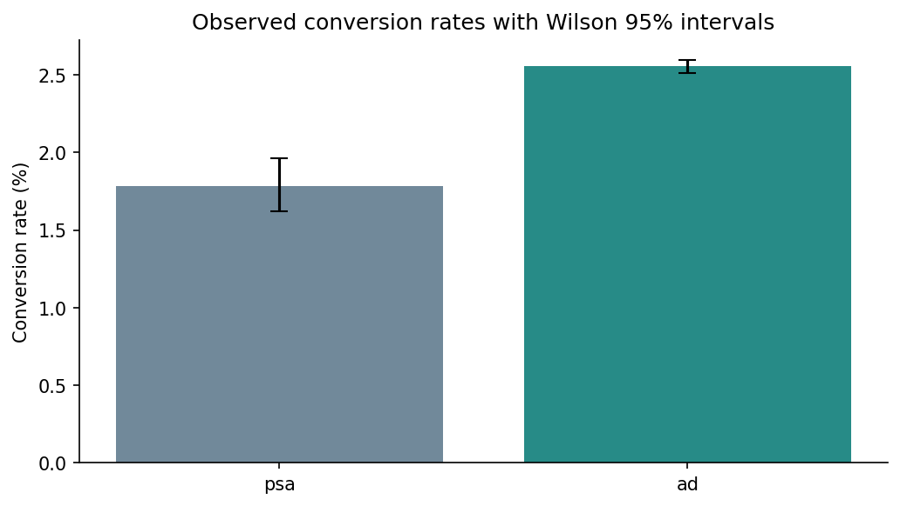
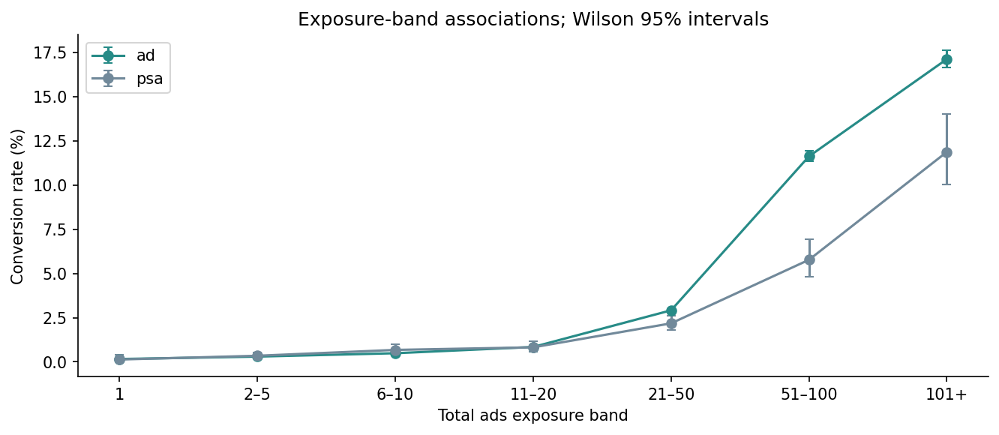
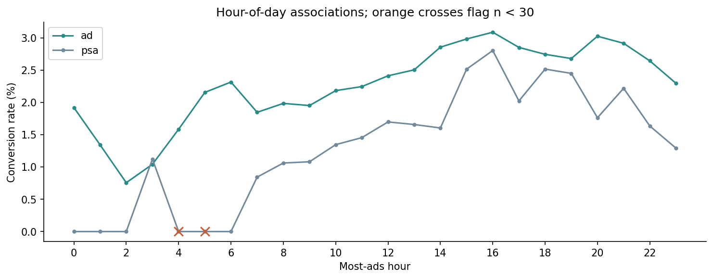
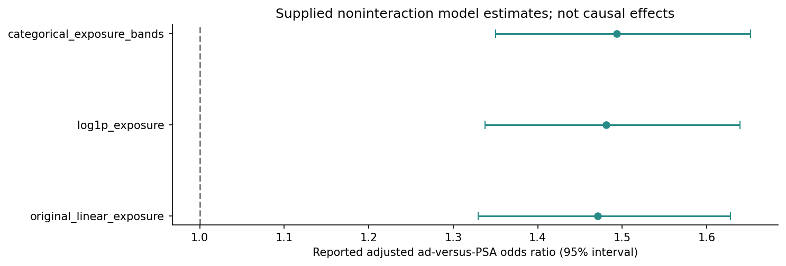
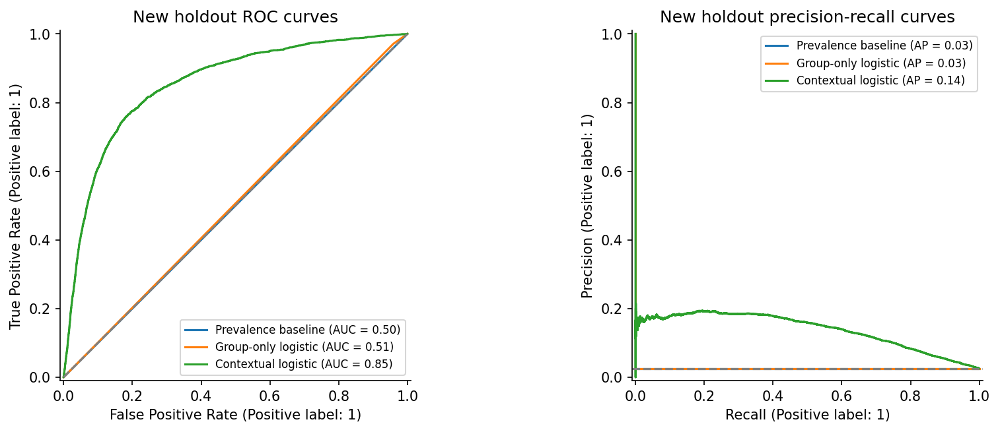

# Marketing A/B Testing Analysis & Conversion Strategy

**Analyzing 588,101 user records to compare advertising and PSA conversions, examine segment patterns, and evaluate machine learning models.**

Users in the advertising group had an observed conversion rate of **2.555%**, compared with **1.785%** in the public service announcement (PSA) group. The difference was **0.769 percentage points**, equivalent to **43.1% relative lift**. This project uses statistical comparisons, segment analysis, supplied logistic-regression diagnostics, and a reproducible Jupyter Notebook to evaluate those findings without inventing observations or business outcomes.

**[Explore the raw dataset](marketing_AB.csv)** | **[View conversion results](group_conversion_summary_final.csv)** | **[Open the Jupyter Notebook](marketing_ab_analysis%20%281%29.ipynb)** | **[View model results](results/new_holdout_model_results.csv)** | **[Use the segmented data](#large-segmented-dataset)**

Raw Dataset Size Notice
The marketing_ab_segmented.csv file exceeds GitHub’s 25 MB browser upload limit and therefore cannot be previewed or uploaded through the standard web interface.
The segmented dataset is generated programmatically from the original marketing_AB.csv file using the project’s data-processing workflow. It can be recreated by running the provided Jupyter Notebook in Google Colab.
This preserves reproducibility and allows users to inspect the complete data transformation process.

## Business Problem

Marketing teams need to understand whether advertising is associated with higher conversion than a PSA comparison group, how patterns vary across exposure and timing, and whether the available information supports useful conversion prediction.

> How do ad and PSA conversion rates compare, which segment patterns merit further testing, and what can statistical and predictive models establish from the supplied data?

The analysis uses **marketing_AB.csv**, a segmented version of the same records, and six supplied summary and regression-output files. Each row of the raw dataset represents one user record, identified by a unique user_id. The outcome is the supplied **converted** indicator.

The records are labeled as an A/B test, but assignment rules, experiment duration, attribution window, and randomization checks are not supplied. The analysis reports observed differences; causal interpretation depends on the underlying experiment design.

## Results at a Glance

| Metric | Result |
| --- | ---: |
| User records analyzed | 588,101 |
| Unique user identifiers | 588,101 |
| Total conversions | 14,843 |
| Advertising-group records | 564,577 |
| PSA-group records | 23,524 |
| Ad conversion rate | 2.555% |
| PSA conversion rate | 1.785% |
| Ad-minus-PSA difference | 0.769 percentage points |
| Relative conversion lift | 43.1% |
| Training / holdout records for new classifiers | 470,480 / 117,621 |

Conversion rate is **the number of converted records divided by the number of records in the relevant group**. Relative lift is the ad conversion rate divided by the PSA conversion rate, minus one. A **43.1% relative lift** is different from an increase of 43.1 percentage points.

### Conversion by Test Group

| Test group | User records | Conversions | Conversion rate | Wilson 95% confidence interval |
| --- | ---: | ---: | ---: | ---: |
| Advertising | 564,577 | 14,423 | 2.555% | 2.514%–2.596% |
| PSA | 23,524 | 420 | 1.785% | 1.624%–1.963% |

The **95% Newcombe interval for the ad-minus-PSA difference is 0.587–0.936 percentage points**. A two-sided Pearson chi-square test without continuity correction gives **chi-square = 54.318** and **p ≈ 1.71 × 10⁻¹³**. These calculations describe statistical evidence for a difference in the supplied observations; they do not independently verify randomization or establish practical profitability.

### Conversion by Exposure Band

| Total ads band | Ad records | PSA records | Ad conversion rate | PSA conversion rate | Ad-minus-PSA gap |
| --- | ---: | ---: | ---: | ---: | ---: |
| 1 | 54,298 | 2,308 | 0.158% | 0.130% | +0.028 pp |
| 2–5 | 115,664 | 5,553 | 0.295% | 0.342% | −0.047 pp |
| 6–10 | 79,537 | 3,415 | 0.485% | 0.673% | −0.188 pp |
| 11–20 | 123,334 | 4,150 | 0.840% | 0.819% | +0.021 pp |
| 21–50 | 125,541 | 5,235 | 2.915% | 2.178% | +0.738 pp |
| 51–100 | 44,149 | 1,853 | 11.631% | 5.774% | +5.857 pp |
| 101+ | 22,054 | 1,010 | 17.135% | 11.881% | +5.254 pp |

**pp** means percentage points. These are exploratory exposure associations. Exposure can reflect behavior after assignment, so higher conversion in high-exposure groups does not prove that increasing ad frequency causes higher conversion.

**Business takeaway:** The advertising group has a higher observed conversion rate overall, while exposure and timing patterns identify questions for controlled follow-up tests. Validate the experiment design and measurement window before treating the observed lift as a causal effect. Evaluate costs and conversion value before making spending recommendations; neither is supplied here.

## Visualizations

### 1. Advertising Versus PSA Conversion Rates

[View the full-size conversion comparison](assets/overall_conversion_rates.png)

**Interpretation:** The advertising rate is **2.555%**, versus **1.785%** for PSA. Error bars show the Wilson interval for each group's conversion rate. The separate interval for their difference is reported above.

### 2. Conversion by Exposure Band

[View the full-size exposure comparison](assets/exposure_band_conversion_rates.png)

**Interpretation:** Observed conversion rises sharply in the higher exposure bands in both groups. The largest observed ad-minus-PSA gap is **5.857 percentage points** in the **51–100** band. These comparisons are descriptive and do not establish an optimal exposure policy.

### 3. Conversion by Most-Ads Hour

[View the full-size hourly comparison](assets/hour_conversion_rates.png)

**Interpretation:** Conversion patterns vary by the recorded hour of greatest ad exposure. The PSA groups at hours **4 and 5** contain only **28 and 23 users**, respectively, with no observed conversions. Orange crosses flag these groups; a zero observed count does not imply a true zero conversion probability.

### 4. Supplied Adjusted Odds Ratios Across Exposure Specifications

[View the full-size odds-ratio comparison](assets/reported_adjusted_odds_ratios.png)

**Interpretation:** The three supplied noninteraction models report adjusted ad-versus-PSA odds ratios of approximately **1.471–1.494**, with their reported intervals above **1.0**. These are adjusted associations, not conversion-rate ratios or proven causal effects. The notebook retains these original inference outputs rather than silently replacing them with newly fitted coefficients.

### 5. New Predictive Models Versus a Prevalence Baseline

[View the full-size holdout ROC and precision-recall comparison](assets/new_holdout_model_curves.png)

**Interpretation:** The contextual classifier achieves holdout **ROC-AUC ≈ 0.853** and **average precision ≈ 0.138**, compared with **0.500** and **0.025** for the baseline. At a fixed threshold of **0.5**, however, it identifies only **17 of 2,969 conversions**. Ranking performance and performance at a specific decision threshold must be evaluated separately.

All five PNGs come from the tested notebook workflow. The **assets/** directory contains the images referenced here.

## Approach & Tools

**Analysis environment:** Python and Jupyter Notebook. **Data preparation and checks:** pandas and NumPy. **Statistical comparisons:** SciPy. **Machine learning:** scikit-learn. **Visualization:** Matplotlib.

1. **Verify the inputs:** Check source-file hashes, row counts, user identifiers, outcomes, and missing values across all eight supplied inputs.
2. **Load or reconstruct segmented data:** Read the large file locally, or recreate its six derived columns from every original raw record.
3. **Compare overall conversions:** Recalculate group counts, conversion rates, Wilson intervals, absolute difference, relative lift, and the chi-square test.
4. **Explore segments:** Reproduce all 76 exposure, day, and hour summary rows, including confidence intervals and small-cell flags.
5. **Review supplied regression outputs:** Inspect original odds ratios, VIF, exposure-specification comparisons, and interaction terms without presenting them as newly refitted results.
6. **Train separate predictive models:** Compare a prevalence baseline, group-only logistic regression, and contextual logistic regression using a reproducible holdout split.

The contextual model uses **test_group, log1p(total_ads), most_ads_day, and most_ads_hour**. Categorical encoding and numeric scaling are fitted on training records only. Identifiers, the conversion outcome, converted_bool, and the small-cell flags are excluded from model features. No oversampling, class weighting, or synthetic observations are used.

### Supplied Logistic-Regression Findings

| Exposure specification | Reported adjusted ad-versus-PSA odds ratio | Reported 95% confidence interval |
| --- | ---: | ---: |
| Linear total_ads | 1.471 | 1.330–1.628 |
| log1p(total_ads) | 1.481 | 1.338–1.639 |
| Categorical exposure bands | 1.494 | 1.350–1.652 |

The supplied interaction model's main ad coefficient applies only to the **reference exposure band**. It is not an overall treatment effect. Its joint interaction comparison and individual interaction tests answer different questions; the notebook reports them separately. Band-specific confidence intervals cannot be obtained by simply multiplying the supplied intervals without coefficient covariance.

The supplied VIF table contains **31 design columns**, with a maximum VIF of approximately **8.83**. This diagnostic depends on categorical reference coding and does not establish model validity or causality. The saved robustness CSV reports convergence for all four specifications; its fit metrics have no documented holdout design and are kept separate from the fresh evaluation below.

### Model Evaluation

| New predictive model | Holdout ROC-AUC | Holdout average precision | Holdout Brier score | Holdout accuracy |
| --- | ---: | ---: | ---: | ---: |
| Prevalence baseline | 0.500 | 0.025 | 0.02460 | 97.48% |
| Group-only logistic regression | 0.506 | 0.026 | 0.02460 | 97.48% |
| **Contextual logistic regression** | **0.853** | **0.138** | **0.02325** | **97.40%** |

These are newly trained regularized classifiers, distinct from the supplied inferential logistic-regression tables. The split is **80% training / 20% holdout**, stratified jointly by test group and conversion with **seed 42**. No test-set threshold tuning or hyperparameter selection is performed.

The tables and chart files use the locally validated run. The executed notebook in this repository agrees at the precision shown; minor runtime differences appear in later decimal places.

| Contextual classifier metric | Holdout result | What it measures |
| --- | ---: | --- |
| ROC-AUC | 0.853 | Ranking converted versus nonconverted records |
| Average precision | 0.138 | Precision-recall summary across thresholds |
| Precision at threshold 0.5 | 13.9% | Share of flagged users who converted |
| Recall at threshold 0.5 | 0.57% | Share of conversions identified |
| True positives / false positives | 17 / 105 | Converted and nonconverted records flagged |
| False negatives / true negatives | 2,952 / 114,547 | Converted and nonconverted records not flagged |

Only about **2.52%** of holdout users convert. Predicting nonconversion for everyone yields **97.48% accuracy**, illustrating why accuracy alone is insufficient. The contextual model contains exposure and timing information whose availability before conversion is undocumented, so this is retrospective classification, not a validated pre-exposure targeting or causal uplift model.

## Large Segmented Dataset

The supplied **marketing_ab_segmented.csv** contains **588,101 rows and 13 columns**, totaling **44,213,874 bytes**. It is larger than GitHub's **25 MiB browser upload limit** and is intentionally kept outside this repository.

The notebook's **section 4** supports two routes:

1. **Use the supplied file:** put it in a local data/ folder, beside the notebook, or set SEGMENTED_PATH to its location. In Colab, enable USE_COLAB_UPLOAD or use a mounted Google Drive path.
2. **Reconstruct from the raw dataset:** when the large file is absent, retain all original raw records and derive converted_bool, total_ads_bin, exposure_small_cell, day_small_cell, hour_small_cell, and small_cell. No new user records are created.

The exposure bands are **1, 2–5, 6–10, 11–20, 21–50, 51–100, and 101+**. A small cell has **fewer than 30 users within a test group and segment**; the combined flag is the union of the exposure, day, and hour flags.

Both routes were tested against the supplied segmented file. All original fields, derived values, and row order matched, and the holdout model results matched between routes within the validation tolerance. The raw **marketing_AB.csv** is approximately **21.5 MiB** and can be used directly from this repository.

To run the repository notebook in Colab, upload marketing_AB.csv when prompted after enabling USE_COLAB_UPLOAD. The six small supplied report tables are embedded verbatim as fallbacks, so the analysis can run without uploading the large segmented CSV. A GitHub notebook preview displays saved outputs; executing it requires a Python notebook environment.

## Data Validation

| Validation check | Result | What it establishes |
| --- | ---: | --- |
| Raw user records | 588,101 | All supplied raw observations are included |
| Unique user identifiers | 588,101 | No duplicate user IDs |
| Duplicate full raw rows | 0 | No identical full-row duplicates |
| Missing raw source cells | 0 | All seven original columns are populated |
| Conversions / nonconversions | 14,843 / 573,258 | Outcome totals agree with the supplied data |
| Group summary rows | 2 reproduced | Counts, rates, and Wilson intervals match |
| Segment summary rows | 76 reproduced | Counts, rates, intervals, gaps, and flags match |
| Small-cell flags | 51 user records | PSA hours 4 and 5 are flagged under the n < 30 rule |
| Supplied inputs | 8 accounted for | Seven repository CSVs plus the external segmented dataset |
| Original segmented data versus reconstruction | All values and row order match | The GitHub-friendly route retains the same observations |
| Notebook validation | 11 code cells per route; 0 errors | Both routes complete through all analysis sections |
| Holdout results across routes | Match within 1e-12 | Loading and reconstruction yield consistent model evaluations |

Original source files remain unchanged. The notebook uses SHA-256 identifiers to verify supplied file contents, and its run manifest records the runtime, split fingerprint, features, and segmented-data route. Successful execution does not independently validate the experiment assignment or attribution process.

## Recommended Marketing Experiments

| Business priority | Proposed test or investigation | Outcome to measure |
| --- | --- | --- |
| Validate the overall ad comparison | Confirm randomization, allocation rules, attribution window, and measurement consistency | A reproducible conversion contrast under a documented design |
| Evaluate exposure frequency | Randomize frequency caps or exposure policies while holding other campaign conditions comparable | Conversion difference, cost per incremental conversion, and uncertainty |
| Investigate timing patterns | Run a preregistered scheduling experiment with adequate samples in each planned comparison | Conversion outcomes under randomized delivery schedules |
| Assess targeting usefulness | Define a pre-conversion feature cutoff and compare a targeting policy with a baseline policy | Incremental conversions and calibrated performance on new users |

These are proposed experiments. The project does not report implemented campaign changes, realized revenue, advertising costs, or financial savings. The observational exposure-band comparisons alone do not justify increasing ad frequency.

## Limitations & Next Steps

- **Experiment design:** Assignment rules, planned group proportions, duration, and randomization checks are not supplied. No 50/50 allocation assumption is imposed.
- **Measurement:** Conversion dates and the attribution window are unavailable, limiting time-based validation and interpretation.
- **Post-assignment information:** Exposure and most-ads timing may be influenced by user behavior after assignment; adjusted associations are not automatically causal effects.
- **Exploratory comparisons:** Day, hour, and exposure summaries involve multiple comparisons, including sparse groups. Apparent subgroup differences require confirmation.
- **Class imbalance and thresholds:** High nonconversion accuracy masks low conversion recall at threshold 0.5. Threshold selection needs a separate validation process and business costs.
- **Original versus new models:** Supplied odds ratios and diagnostics are retained as reported. Fresh predictive classifiers are evaluated separately and do not reproduce the original inferential fitting process.
- **Business value:** Cost and conversion-value data are absent, so ROI and profitability cannot be estimated from these files alone.
- **External validation:** A random holdout evaluates discrimination within the supplied dataset; a future deployment needs a documented prediction cutoff and independent validation.

## Project Files

| File | Contents |
| --- | --- |
| [Raw dataset](marketing_AB.csv) | 588,101 user records and seven original columns |
| [Segmented dataset workflow](#large-segmented-dataset) | Local loading or exact reconstruction of the external 13-column dataset |
| [Jupyter Notebook](marketing_ab_analysis%20%281%29.ipynb) | Executed analysis using all eight supplied inputs |
| [Group conversion summary](group_conversion_summary_final.csv) | Two test-group counts, rates, and Wilson intervals |
| [Segment conversion summary](segment_conversion_summary.csv) | 76 exposure, day, and hour summary rows |
| [Supplied odds-ratio table](logistic_regression_or_table.csv) | Original logistic-regression estimates, confidence intervals, and p-values |
| [Supplied VIF diagnostics](logistic_regression_vif.csv) | Original design-column multicollinearity diagnostics |
| [Supplied interaction terms](logit_interaction_terms.csv) | Exposure-band interaction estimates and odds multipliers |
| [Supplied robustness comparison](logit_robustness_comparison.csv) | Exposure specifications, reported fit metrics, and convergence flags |
| [Observed A/B difference](results/ad_psa_effect.csv) | Recalculated difference, interval, relative lift, and chi-square test |
| [New holdout model results](results/new_holdout_model_results.csv) | Fresh baseline and logistic classifier evaluation |
| [Validated run manifest](results/run_manifest.json) | Input hashes, runtime versions, split fingerprint, and data-loading mode |
| [Two-route validation report](results/validation_summary.json) | Successful execution and agreement checks for both data routes |
| [Overall conversion visualization](assets/overall_conversion_rates.png) | Group conversion rates with Wilson intervals |
| [Exposure visualization](assets/exposure_band_conversion_rates.png) | Seven exposure bands compared across groups |
| [Hourly visualization](assets/hour_conversion_rates.png) | Hourly conversion patterns with sparse groups flagged |
| [Adjusted odds-ratio visualization](assets/reported_adjusted_odds_ratios.png) | Supplied estimates under three noninteraction specifications |
| [Holdout model visualization](assets/new_holdout_model_curves.png) | ROC and precision-recall curves for the new predictive models |

Source: [Marketing A/B Testing Analysis repository](https://github.com/condorlamar-ctrl/Marketing-AB-Testing-Analysis-). Upload guidance: [GitHub file-upload limits](https://docs.github.com/en/repositories/working-with-files/managing-files/adding-a-file-to-a-repository).
